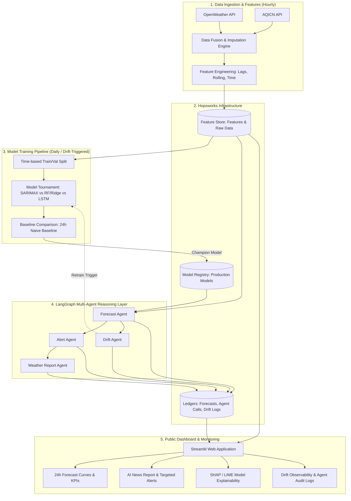

# AgentWeather 🌦️🤖
### Autonomous Multi-Metric Weather & Air Quality Forecasting System
*Developed for 10Pearls SHINE Internship Program — Cohort 10 (Data Science Track)*

[](https://www.python.org/)
[](https://www.hopsworks.ai/)
[](https://langchain-ai.github.io/langgraph/)
[](https://github.com/features/actions)
[](https://streamlit.io/)

---

## 📌 Executive Summary
**AgentWeather** is an enterprise-grade, serverless machine learning and autonomous agent system that predicts **six weather and air-quality metrics** for the next 24 hours. 

Beyond classical time-series prediction, AgentWeather introduces an **Agentic Reasoning Layer** powered by **LangGraph** and LLMs (Groq). The agents autonomously:
1. Generate forecasts from production models in the registry.
2. Evaluate environmental hazard thresholds and trigger targeted public safety alerts.
3. Synthesize human-readable, news-style weather advisories.
4. Monitor live data drift and model performance degradation to trigger automated retraining pipelines.

---

## 🏗️ System Architecture



---

## 🎯 Target Metrics (24-Hour Ahead Forecast)
| Metric | Unit / Format | Modeling Strategy |
| :--- | :--- | :--- |
| **Air Quality Index (AQI)** | Index (0–500) | Multi-pollutant lag fusion (PM2.5, PM10, NO2, O3) |
| **Temperature** | Celsius (°C) | Diurnal cycle decomposition & rolling trend |
| **Precipitation** | Quantity (mm) & Probability (%) | Two-stage hurdle model / classification + regression |
| **Relative Humidity** | Percentage (%) | Dew point and temperature correlation features |
| **UV Index** | Index (0–12+) | Solar zenith angle and cloud cover interaction |
| **Wind** | Speed (m/s) & Direction (Degrees) | Vector decomposition ($U$ & $V$ wind components) |

---

## 🤖 LangGraph Multi-Agent System
All agents operate as coordinated nodes sharing a unified state ledger:

- **Forecast Agent**: Queries the feature store, loads champion models from Hopsworks Model Registry, outputs 24h predictions, and updates the Forecast Ledger.
- **Alert Agent**: Evaluates rule-based hazardous thresholds across vulnerable demographics (General Public, Sensitive Groups, Outdoor Workers).
- **Weather Report Agent**: LLM-driven synthesis creating a broadcast-quality daily briefing combining forecasts, extremes, and safety tips.
- **Drift Agent**: Calculates statistical data drift (Kolmogorov-Smirnov / PSI) and model residual drift; triggers automated retraining when drift exceeds tolerance.

---

## 📁 Repository Directory Structure

```text
agent-weather/
├── .github/
│   └── workflows/
│       ├── feature_pipeline.yml       # Hourly feature extraction cron
│       └── training_pipeline.yml      # Daily & drift-triggered training cron
├── config/
│   └── settings.yaml                  # System thresholds, API configs & paths
├── data/                              # Local caching & schema definitions
├── notebooks/
│   ├── 01_eda_and_storytelling.ipynb  # Comprehensive EDA across all 6 metrics
│   └── 02_model_experiments.ipynb    # Model benchmarks & SHAP explanations
├── src/
│   ├── agents/                        # LangGraph agent definitions
│   │   ├── alert_agent.py
│   │   ├── drift_agent.py
│   │   ├── forecast_agent.py
│   │   ├── state.py
│   │   └── weather_report_agent.py
│   ├── features/                      # Ingestion, fusion, imputation & lags
│   │   ├── feature_store.py
│   │   └── ingest.py
│   ├── models/                        # Baseline, classical, statistical & deep learning
│   │   ├── evaluate.py
│   │   ├── registry.py
│   │   └── train.py
│   └── utils/                         # LLM client, logger, and helper utilities
├── dashboard/
│   └── app.py                         # Streamlit interactive production dashboard
├── tests/                             # Unit and integration test suite
├── .gitignore
├── requirements.txt
└── README.md
```

---

## 🗓️ 30-Day Engineering Roadmap
- [x] **Phase 0: Architecture & Scaffolding** (Repo setup, spec validation, environment configuration)
- [ ] **Phase 1: Ingestion & Feature Pipeline** (OpenWeather/AQICN fusion, backfill, Hopsworks feature groups)
- [ ] **Phase 2: Exploratory Data Analysis & Explainability** (EDA, seasonality analysis, SHAP/LIME)
- [ ] **Phase 3: Model Tournament & Evaluation** (SARIMAX/Prophet vs Random Forest/XGBoost vs LSTM vs Naive Baseline)
- [ ] **Phase 4: LangGraph Agentic Layer** (4-Agent workflow, state persistence, Groq fallback logic)
- [ ] **Phase 5: Automation & CI/CD** (GitHub Actions cron workflows, secret management)
- [ ] **Phase 6: Dashboard & Deployment** (Streamlit Cloud UI, observability panel, audit trail)

---

## 👨‍💻 Author
**Syed Muhammad Arham**  
Data Science Intern — 10Pearls SHINE Program (Cohort 10)  
Portfolio / Candidate ID: `syedmuhammadarham`
